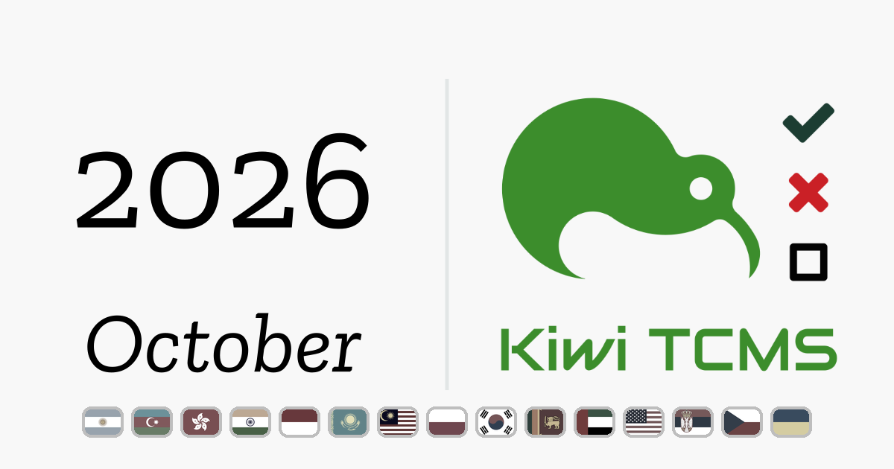

Title: Who is using Kiwi TCMS in Oct 2026
Headline: discover 23 organizations out of 250 total
date: 2026-11-02 14:15
comments: false
og_image: images/analytics/2026/banner+oct2026.png
twitter_image: images/analytics/2026/banner+oct2026.png
tags: community

October 2026 brought another wave of organizations whose Kiwi TCMS instances
crossed the 1000-events mark for the first time. Below is a short, by no means
exhaustive, look at who they are and what they do.

*Disclaimer: the information below was obtained via anonymous analytics and
represents only instances of Kiwi TCMS which crossed 1000 events during
October 2026. We've used publicly available data in order to identify these
organizations. Note that we don't keep track of individuals or IP addresses!*

### Argentina

- [Farmanet S.A.](https://www.farmanet.com.ar/) - *digital self-management platform*
[comment]: <> (^^^ original domain: kiwi.farmanet.com.ar)

### Azerbaijan

- [PASHA Insurance](https://pasha-insurance.az/) - *insurance products and services*
[comment]: <> (^^^ original domain: tcms.pasha-insurance.az)

### Hong Kong

- [TOPPAN Nexus](https://toppannexus.com/) - *financial communications, typesetting and printing services*
[comment]: <> (^^^ original domain: kiwiprod.app.toppannexus.com)

### India

- [Anaxion AI](https://anaxionai.com/) - *AI-first career training institute*
[comment]: <> (^^^ original domain: kiwi.anaxionai.com)
- [Lifenity Health](https://lifenityhealth.com/) - *NABL-accredited diagnostic lab with home sample collection*
[comment]: <> (^^^ original domain: tcms.lifenityhealth.com)
- [Tetranetics Private Limited](https://tetranetics.com/) - *AI-powered telecommunications and omnichannel contact center software*
[comment]: <> (^^^ original domain: kiwi.tetranetics-services.com; identified via Google search)

### Indonesia

- [Konten.com](https://konten.com/) - *creator and clipper marketplace*
[comment]: <> (^^^ original domain: qa.konten.com)
- [Snapcart](https://snapcart.global/) - *data-driven market research and analytics*
[comment]: <> (^^^ original domain: kiwi.snapgreen.world; identified via Google search)

### Kazakhstan

- [Kazprom Avtomatika](https://www.avtomatika.kz/) - *industrial automation and MESone manufacturing execution system for mining and industrial enterprises*
[comment]: <> (^^^ original domain: kiwi.mesone.kz; identified via whois and Google search)

### Malaysia

- [Kollect Systems](https://kollect.biz/) - *AI-driven debt recovery and receivables platform*
[comment]: <> (^^^ original domain: ktm.kollect.biz)

### Poland

- [Grupa Energia](https://grupaenergianovage.pl/) - *electricity trading and distribution for commercial customers*
[comment]: <> (^^^ original domain: kiwi.shared.aws.grupa-energia.pl; grupa-energia.pl is a placeholder; current sites: grupaenergianovage.pl and grupaenergiaobrotge.pl)
- [Rampnow](https://rampnow.io/en) - *crypto on- and off-ramp platform*
[comment]: <> (^^^ original domain: kiwi.rampnow.io)
- [RECTOR POLSKA](https://www.rector.pl/) - *manufacturer of pre-stressed concrete rib-and-block floor systems and construction elements*
[comment]: <> (^^^ original domain: kiwi.lodz.rector.com.pl; identified via Google search)

### South Korea

- [Yonhap Infomax](https://en.infomaxai.com/) - *financial news and data provider*
[comment]: <> (^^^ original domain: qc.infomax-asp.com; identified via Google search)

### Sri Lanka

- [Zone24x7](https://zone24x7.lk/) - *technology solutions provider*
[comment]: <> (^^^ original domain: kiwitcms.zone24x7.lk)

### United Arab Emirates

- [Lost In Extraction](https://lostinextraction.com/) - *extraction shooter game for PC and mobile, by SP Interactive L.L.C.-FZ*
[comment]: <> (^^^ original domain: kiwi-dev.lostinextraction.com; SP Interactive L.L.C.-FZ, Meydan Grandstand, Nad Al Sheba, Dubai, UAE)

### USA

- [Acrosoft](https://acrosoft.io/) - *AI software development company*
[comment]: <> (^^^ original domain: kiwi.acrosoft.io)
- [Corpsoft Solutions](https://corpsoft.io/) - *custom software development*
[comment]: <> (^^^ original domain: kiwi.ahura.corpsoftsolution.com; identified via Google search)
- [Lumi Wellness Portal](https://lumiwellnessportal.com/) - *personal health workspace and patient portal*
[comment]: <> (^^^ original domain: api.mywellnessportal.net; identified via Google search)
- [TrackRevenue](https://trackrevenue.com/) - *performance network platform*
[comment]: <> (^^^ original domain: tcms.trackrevenue.com)

### Academia & Education

- [Academy of Applied Studies Western Serbia](https://va.akademijazs.edu.rs/) - *higher vocational education, Valjevo, Serbia*
[comment]: <> (^^^ original domain: kiwitcms.vipos.edu.rs)

### Government

- [State Treasury Shared Services Center (SPCSS)](https://spcss.cz/) - *provider of data-center and cybersecurity services for the Czech public administration*
[comment]: <> (^^^ original domain: aisg-build.spcss.cz; Czech name: Státní pokladna Centrum sdílených služeb, s. p.)
- [Decarbonization Fund of Ukraine](https://fdu.com.ua/) - *energy-efficiency financing for businesses and municipalities*
[comment]: <> (^^^ original domain: tests.fdu.com.ua)

---

If you like what we're doing and how Kiwi TCMS supports various communities
please help us!

- [Give ⭐ on GitHub](https://github.com/kiwitcms/kiwitcms/stargazers);
- [Join our newsletter](https://kiwitcms.us17.list-manage.com/subscribe?u=9b57a21155a3b7c655ae8f922&id=c970a37581)
  and follow all project news;
- [Become a contributor](https://kiwitcms.readthedocs.io/en/latest/contribution.html) and an awesome open source hacker;
- [Become a subscriber](/#subscriptions) and help us sustain development;
- [Become a reseller]({filename}pages/partners.html) and help us serve your community
