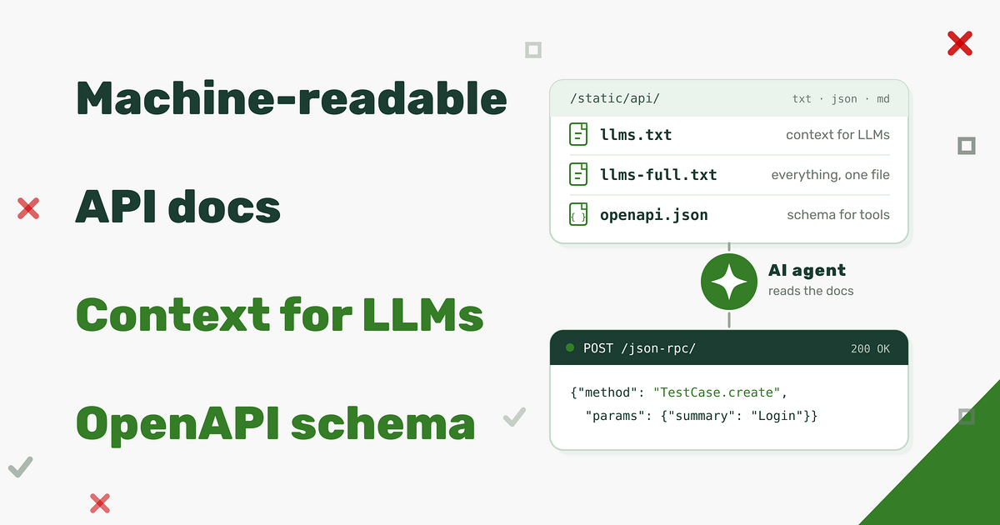
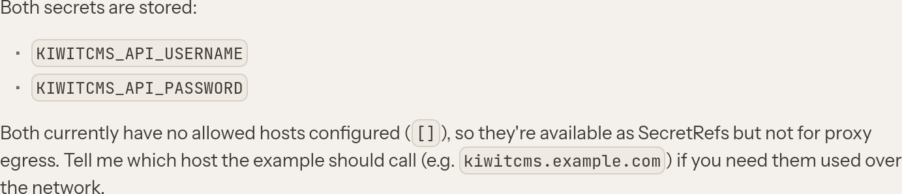
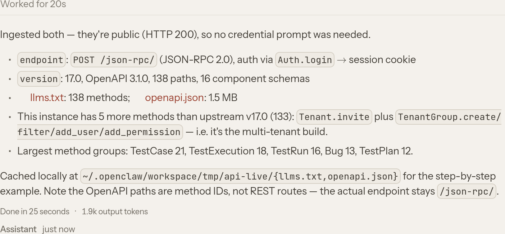
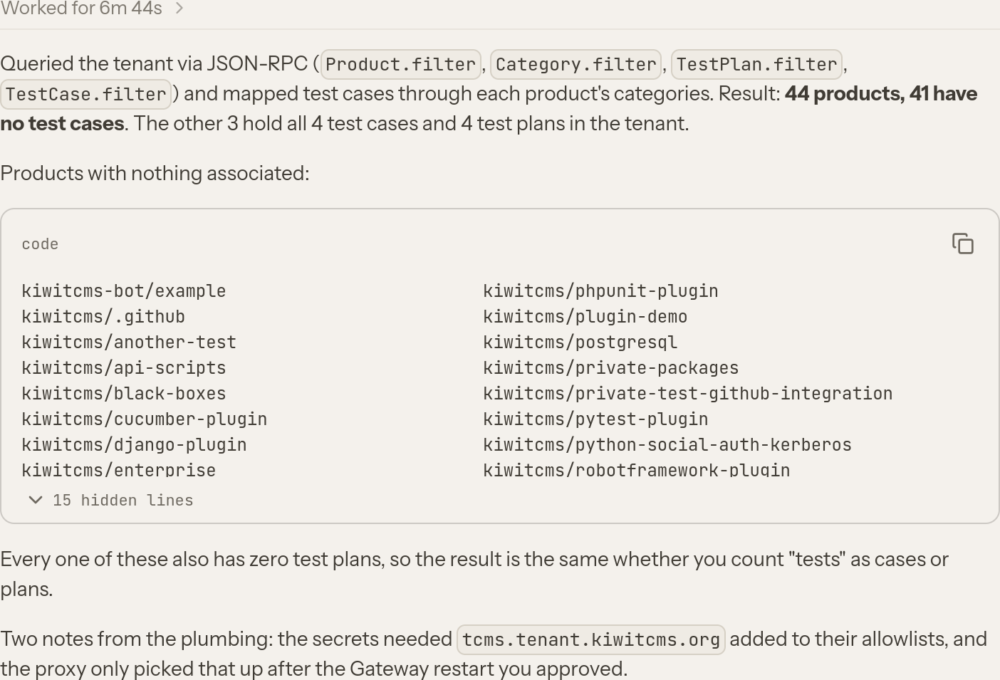
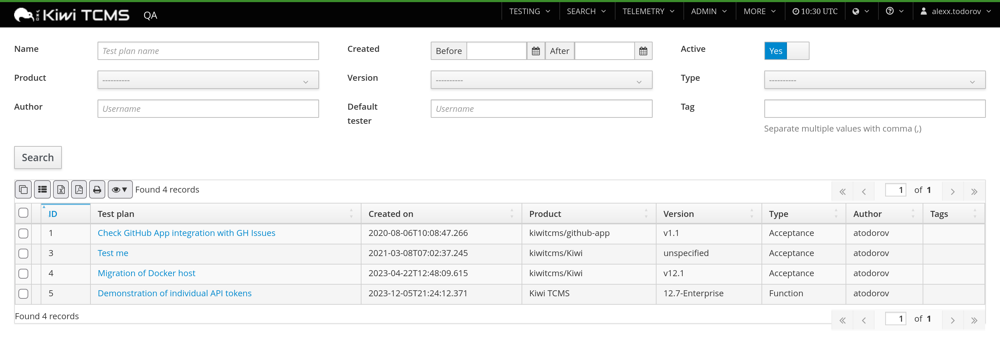
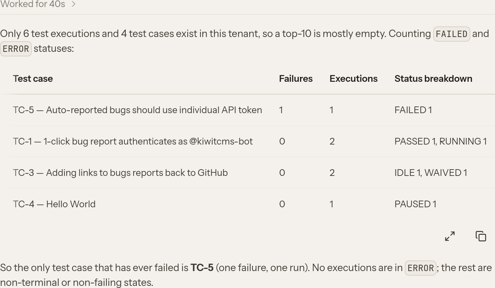
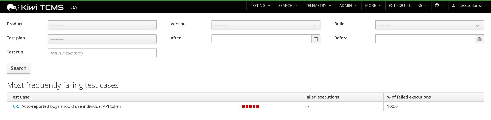

Title: Feature spotlight: Machine-readable API docs
Headline: built for agents, readable by humans too
date: 2026-11-04 13:30
comments: true
og_image: images/features/api-help/banner.png
twitter_image: images/features/api-help/banner.png
tags: features



Kiwi TCMS has a rich API covering its entire data model. This API is exported via
XML-RPC and JSON-RPC protocols. Until now API method reference lived in the
[official documentation](https://kiwitcms.readthedocs.io/en/latest/modules/tcms.rpc.api.html) -
a long list of method signatures meant to be read by a person, top to bottom.

That works reasonably for a human developer however it is not optimal for a
coding assistant: large language models and agentic
tools need the API description as *context* - more structured, complete, example rich
and small enough to fit into a prompt. Starting with **Kiwi TCMS v17.0** every instance ships a
machine-readable description of the available API under `https://<kiwitcms-host>/static/api/`.


## What's new

Four different descriptions of the same data, generated from the existing API registry:

- `https://<kiwitcms-host>/static/api/llms.txt` - an index of every API method with a one-line summary and
  a link to its detail page. This is the entry point for an agent: small, cheap to
  load and enough to decide which method to look at;
- `https://<kiwitcms-host>/static/api/llms-full.txt` - the full reference in a single plain-text file, for
  when you want to paste the entire API into a context window;
- `https://<kiwitcms-host>/static/api/methods/<Method>.md` - one Markdown file per method with parameters,
  examples, allowed query keys and return value;
- `https://<kiwitcms-host>/static/api/openapi.json` - an OpenAPI document describing every method as
  an operation.

The files are static assets, so they can be fetched with plain `curl` or handed to
an HTTP client inside your tooling!

One important detail: the paths in `openapi.json` identify **individual JSON-RPC
methods**, they are not REST routes. Every operation is still a `POST` to
`/json-rpc/` with a JSON-RPC envelope, and authentication is still done via
`Auth.login`, which sets a session cookie. The OpenAPI document exists so that
agents and API tooling can discover the available operations; it does not turn the
API into REST.


## How the documentation is built

All of these files are built automatically by the command

```
manage.py generate_rpc_schema
```

which runs at build time and writes to `STATIC_ROOT/api` by default. The command
iterates the registered API methods and combines three sources of information:

- the Python type annotations on each method, including the `ModelQuery` and
  `FormValues` annotations which tell the generator that an argument is a set of
  database field lookups or a form-validated payload;
- Database model and form metadata, which is where field types, choices, relations
  and lookup names come from;
- the method doc-strings, parsed into a summary, parameter descriptions and return
  values.

The result is converted into JSON Schema fragments, then rendered into the formats above.
Because generation happens as part of the build, the files always
describe the exact version that is running and they are always in sync with the current
implementation. On a Kiwi TCMS v17.0 instance the command reports 133 methods.

**IMPORTANT:** you should ask your agentic tool to refresh its definitions when new Kiwi
TCMS versions are released. Otherwise it may create invalid calls and/or miss on new
API methods!


## Method files and their examples

The per-method Markdown description is the most useful part when an AI model needs to call one
specific operation. Parameters are listed with their required/optional status and,
where applicable, with **examples**. For example, `TestPlan.filter` is documented
with these example queries:

```
Examples:
    `{}`,
    `{"name__icontains": "..."}`,
    `{"name__in": ["...", "..."]}`,
    `{"id__in": [1, 2, 3]}`,
    `{"id__range": [1, 10]}`,
    `{"is_active": true}`,
    `{"is_active__isnull": false}`,
    `{"create_date__gte": "2026-01-01T00:00:00"}`,
    `{"create_date__year": 2026}`,
    `{"parent__name": "..."}`,
    `{"parent__name__icontains": "..."}`
```

These examples are not decorative. They are generated from the field types present
on the model and then validated against the internal `inspect_rpc_args()` function,
i.e. a model can copy one of them into a request without getting an argument-validation error.
The same file also lists the allowed query keys for the method and the relations that can be
traversed:

```
Allowed query keys:
    `create_date__gte`,
    `id__in`,
    `is_active__isnull`,
    `name__icontains`,
    `parent`,
    `product`,
    `product_version`,
    `text__contains`,
    ...
Relations:
    `author` -> auth.User,
    `parent` -> testplans.TestPlan,
    `product` -> management.Product,
    `product_version` -> management.Version,
    `type` -> testplans.PlanType
```

Query arguments use the internal ORM lookup syntax - `<field>__<lookup>` or
`<relation>__<field>__<lookup>` - so `__in` takes an array, `__isnull` a boolean and
`__range` a two-element array. This is the part that tends to be guessed wrong by
code generators, which is exactly why it is spelled out per method.


## What is it useful for

The obvious use case is giving an agent enough context to write a working
integration without a human translating the docs first. Here are some straightforward examples:

- **Importing existing test cases** from another test management system or data dump file(s) -
  `TestCase.create` plus `TestPlan.add_case`;
- **Ingesting automated test results** from a CI job - parse the logs and create a test run with
  `TestRun.create`, add cases, then report each result with
  `TestExecution.create` / `TestExecution.update`;
- **Writing your own test runner plugin** - the plugin needs to create runs and
  report statuses, and can be developed against `llms.txt` and the method files;
- **Producing reports** - `TestPlan.filter`, `TestRun.filter` and
  `TestExecution.filter` methods accept powerful lookups without the rigidity
  of a fixed UI. Extracting data for a custom dashboard, or even inside an AI chat prompt
  is going to be much more easier.

Because the files are plain text, they are equally useful to people, should you choose to read them:
`llms.txt` reads as a table of contents for the API, and a per-method Markdown files answers
the question "what arguments does this take, and what does a valid call look like"!


## Example session

The following is an example session from MyClaw.ai with the *DeepSeek V4.1 Flash* model:

Prompt:
```
>> open a prompt for entering 2 secrets called `KIWITCMS_API_USERNAME` and `KIWITCMS_API_PASSWORD`
```



Note that you may also specify `Allowed hosts` for these secrets. In fact the agent was able to figure this
out and adjust by itself as seen after the first response when it needed to actually call the API.


Prompt:
```
>> Ingest Kiwi TCMS API description: https://tcms.tenant.kiwitcms.org/static/api/llms.txt and https://tcms.tenant.kiwitcms.org/static/api/openapi.json
```




Prompt:
```
>> tell me which products don't have any tests associated with them
```



which can be cross referenced by looking at the `Search Test Plans` page


Indeed there are only 3 products for which we have Test Plans and therefore test. Notice how the AI agent
actually attempted a slightly broader definition of that it means to "not have tests"!


Prompt:
```
>> Show me the top-10 most frequently failing test cases
```



which is the meaning behind the existing `TestCase health` Telemetry page:


Notice again that the agent is trying to give you a broader response compared to what the actual
Telemetry page shows! You may need to refine your prompt if that's what you want!


Underneath all of these examples the agent created several independent programs.
In this case it selected Python, most likely because its own environment was
already setup for Kiwi TCMS development! Here's how the program which produced the
last response looks like:

```python
import json
import os
import ssl
import urllib.request
import http.cookiejar

BASE = "https://tcms.tenant.kiwitcms.org"
CTX = ssl.create_default_context()
JAR = http.cookiejar.CookieJar()
OPENER = urllib.request.build_opener(
    urllib.request.HTTPCookieProcessor(JAR),
    urllib.request.HTTPSHandler(context=CTX),
)

def rpc(method, params=None, _id=1):
    body = json.dumps({"jsonrpc": "2.0", "method": method, "params": params or [], "id": _id}).encode()
    req = urllib.request.Request(BASE + "/json-rpc/", data=body,
                                 headers={
                                     "Content-Type": "application/json",
                                     "Referer": f"{method}@tcms.tenant.kiwitcms.org",
                                     "User-Agent": "OpenClaw/2026.11",
                                 })
    with OPENER.open(req, timeout=120) as resp:
        data = json.load(resp)
    if "error" in data:
        raise RuntimeError(f"{method}: {data['error']}")
    return data["result"]

rpc("Auth.login", [os.environ["KIWITCMS_API_USERNAME"],
                   os.environ["KIWITCMS_API_PASSWORD"]])

statuses = rpc("TestExecutionStatus.filter", [{}])
execs = rpc("TestExecution.filter", [{}])

print("statuses:", sorted({s["name"] for s in statuses}))
print("executions:", len(execs))
if execs:
    print("execution fields:", sorted(execs[0].keys()))

failing = {"failed", "error"}
agg = {}
for e in execs:
    key = (e["case"], e.get("case__summary") or f'case {e["case"]}')
    a = agg.setdefault(key, {"fail": 0, "total": 0, "statuses": {}})
    a["total"] += 1
    name = (e.get("status__name") or "").strip()
    a["statuses"][name] = a["statuses"].get(name, 0) + 1
    if (e.get("status__name") or "").strip().lower() in failing:
        a["fail"] += 1

rows = sorted(agg.items(), key=lambda kv: (-kv[1]["fail"], kv[0][0]))
print("--- top failing test cases ---")
for (cid, summary), a in rows[:10]:
    print(f'{a["fail"]}\t{a["total"]}\tTC-{cid}\t{summary}\t{a["statuses"]}')
```


Happy Testing!


---

If you like what we're doing and how Kiwi TCMS supports various communities
please help us!

- [Give ⭐ on GitHub](https://github.com/kiwitcms/Kiwi/stargazers);
- [Join our newsletter](https://kiwitcms.us17.list-manage.com/subscribe?u=9b57a21155a3b7c655ae8f922&id=c970a37581)
  and follow all project news;
- [Become a subscriber](/#subscriptions) and help us sustain development
- [Become a reseller]({filename}pages/partners.html) and help us serve your community
