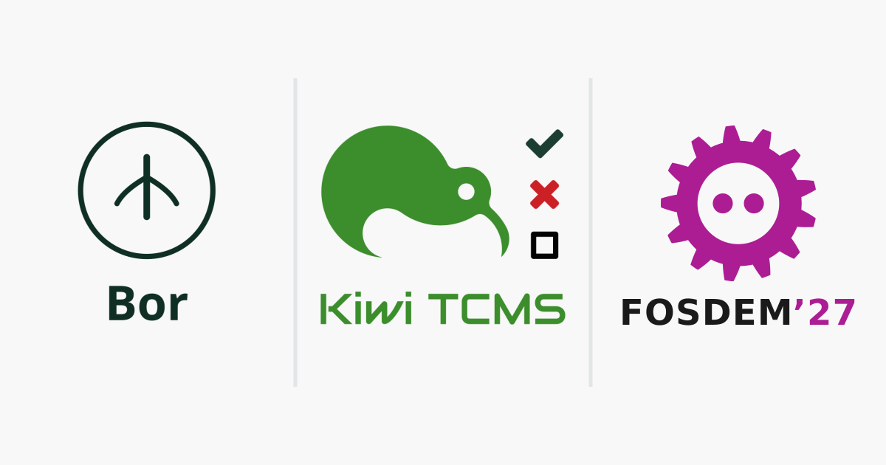

Title: Bor & Kiwi TCMS are going to FOSDEM 2027
Headline: devroom on 30 Jan; stand on 31 Jan
date: 2026-11-10 09:10
og_image: images/fosdem/2027/stand.png
twitter_image: images/fosdem/2027/stand.png
comments: true
tags: community, events

Hello testers, we are happy to announce that
[Bor](https://getbor.dev/) and Kiwi TCMS are going to
[FOSDEM 2027](https://fosdem.org/2027/) in Brussels.
This is where you can find us:

- Saturday Jan 30th:
  [Testing and Continuous Delivery devroom](https://fosdem-testingautomation.github.io/) -
  we are proud to be co-hosting this devroom again!
- Sunday Jan 31st:
  [Bor & Kiwi TCMS stand](https://fosdem.org/2027/news/accepted-stands/) -
  follow <https://fosdem.org/2027/> for the exact building and stand number!

Bor is open source policy management for Linux desktops: define, distribute and
enforce desktop configuration policies across your fleet in real time.
Together with Kiwi TCMS we would like to meet all of you and talk about open source,
software testing, test management and managing Linux desktops at scale!

---

If you like what we're doing and how Kiwi TCMS supports various communities
please help us!

- [Give ⭐ on GitHub](https://github.com/kiwitcms/Kiwi/stargazers);
- [Join our newsletter](https://kiwitcms.us17.list-manage.com/subscribe?u=9b57a21155a3b7c655ae8f922&id=c970a37581)
  and follow all project news;
- [Become a contributor](https://kiwitcms.readthedocs.io/en/latest/contribution.html) and an awesome open source hacker;
- [Become a subscriber](/#subscriptions) and help us sustain development
